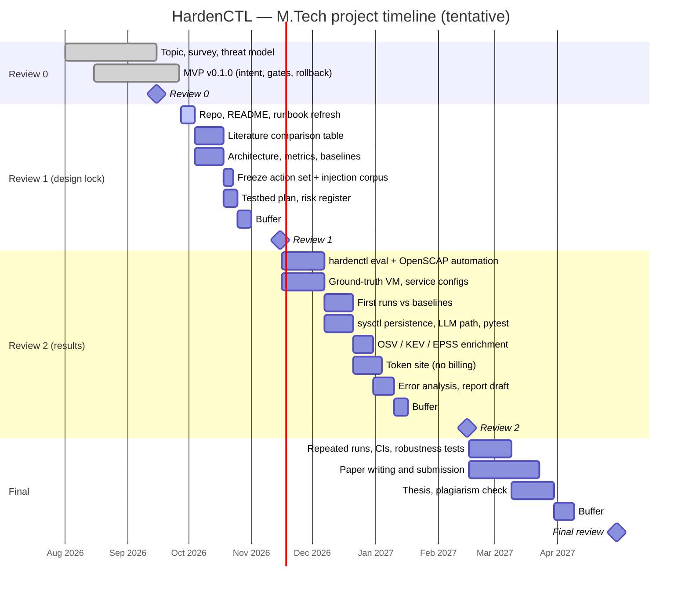

# Review 0 — Tentative Timeline

> **Dates are tentative.** The Review 0 deck listed Review 1 in Nov 2026 and
> Review 2 in Feb 2027; the Final date is not fixed yet. Update this file when
> the department confirms the schedule.

## Milestone summary

| Milestone | Tentative date | Exit criterion |
|---|---|---|
| Review 0 | Sep 2026 (held) | Topic approved; MVP working |
| Review 1 | Nov 2026 | Design locked: action set and injection corpus frozen; metrics and baselines defined |
| Review 2 | Feb 2027 | `hardenctl eval` produces real numbers vs at least one baseline; live demo |
| Final | Apr–May 2027 | Repeated runs with CIs, 2–3 baselines, thesis, paper submitted |

**Cut order if time runs short:** token-site relay → rest of token site →
enrichment. Evaluation (`hardenctl eval`) is never cut.
