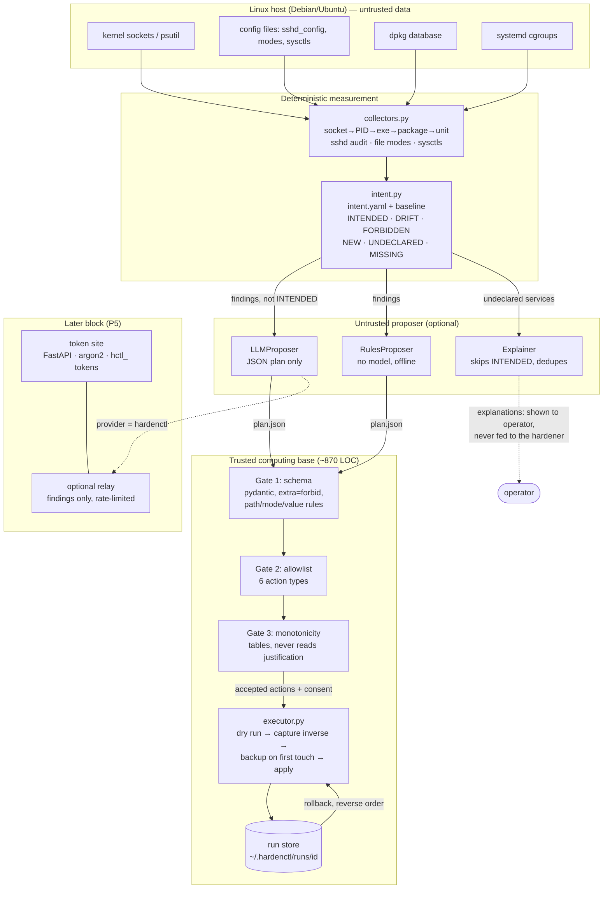

# Review 1 — Architecture and Algorithm Justification

## System architecture

Rendered by GitHub. The ASCII version in the top-level README shows the same
pipeline.

## Algorithm and design choices, with the alternatives rejected

### 1. Table-driven monotonicity gate, not LLM self-critique or a guardrail model

| Option | Why rejected / chosen |
|---|---|
| Ask the same model to critique its plan | The critic reads the same poisoned input; the injection that fooled the proposer can fool the critic |
| A second guardrail model (Llama Guard, NeMo Guardrails) | Probabilistic (see literature table: best defences report <2%, not 0%); trained on content-safety taxonomies, not host-security semantics |
| Model-side training (StruQ, instruction hierarchy) | Requires fine-tuning a model we do not control; excluded by invariant 14; still probabilistic |
| **Deterministic table lookup (chosen)** | Decides on the action's *fields* only, never the justification, so it cannot be persuaded. It is auditable, testable (frozen corpus) and costs nothing at runtime |

Known limitation: a table is a deny-list, so it is only as good as its
coverage. The coverage probes measure this directly (currently 3/12).

### 2. A rules proposer as the baseline

The rules proposer (`hardener.py`, `RulesProposer`) maps findings to CIS
controls with no model. It gives (a) an offline path that always works,
(b) a fair baseline for measuring what the LLM adds, and (c) a fallback when
the provider is unavailable.

### 3. Intent filtering before the model

INTENDED services are never sent to the model. This saves tokens, keeps
declared-good services out of the model's reach (it cannot propose disabling
what it never sees), and shrinks the prompt-injection surface. The token saving
is a reported metric.

### 4. Deduplication in the explainer

Identical services (same unit/process/package on several ports) are explained
once. This reduces cost and removes inconsistent duplicate explanations.

### 5. Closed six-action set, no shell

Six typed actions, each with a known inverse, make rollback always possible
and let gate 3 reason about every action. A shell action would make both
impossible. The set is **frozen at Review 1**: `test_injection.py` fails if
`ALLOWED_ACTIONS` changes.

### 6. Transactional apply

Capture the inverse from live state before each change, back up each file on
first touch, and revert in reverse order on any failure. Chosen over
snapshot-only rollback (a VM snapshot is not available on a real host) and
over package-manager rollback (does not cover config or sysctls).

## Open design decision: closing the gate 3 coverage gap

| Option | Effect | Trade-off |
|---|---|---|
| A. Extend the tables (apparmor/ufw units and packages, `sshd_config.d` suffix, more sshd directives and sysctls, sudoers) | Closes the 9 known gaps | Still a deny-list; the next unknown directive passes |
| B. Default-deny for `set_config_directive` and `set_sysctl`: only (file, directive) and sysctl keys with a known hardened value are allowed | Unknown changes are rejected, not passed | The LLM can propose fewer changes; plan validity (%) may drop |
| C. B for config and sysctls, plus A for units and packages | Strongest closure | Most table work |

**Recommendation: C.** It keeps the claim "a persuaded model cannot weaken the
host" true for unknown directives, not just known ones. The decision and the
before/after coverage number will be recorded in the Review 2 error analysis.
